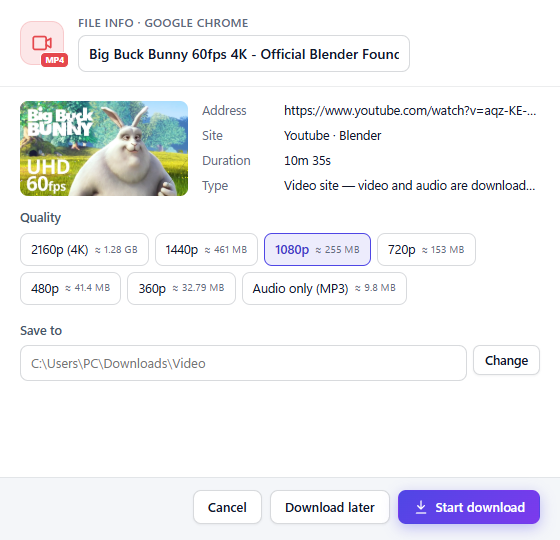
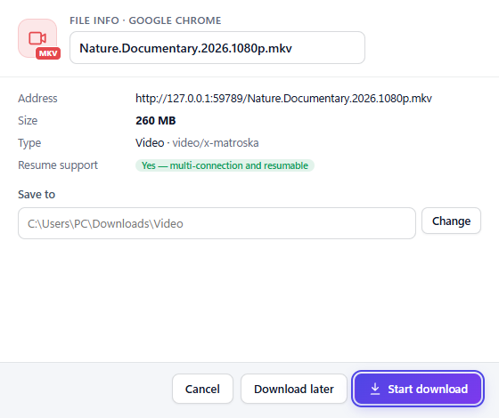
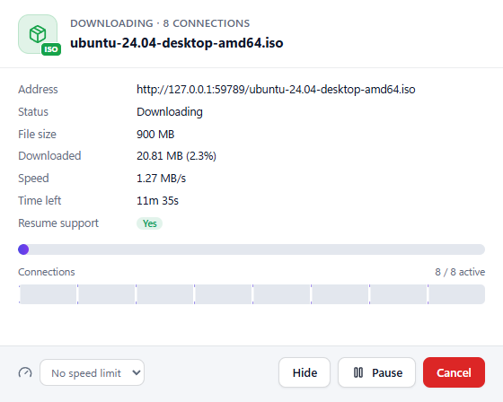
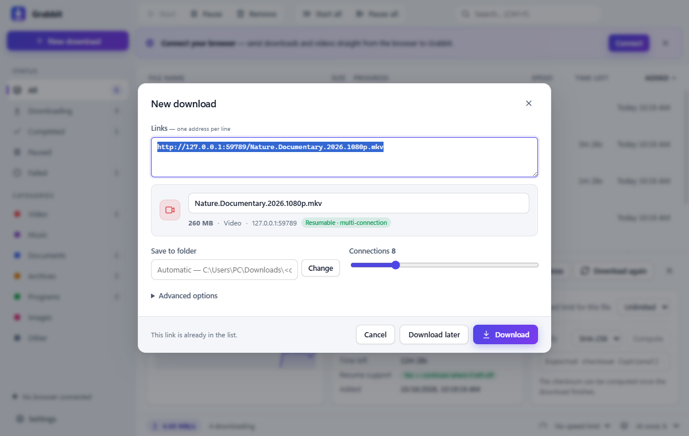
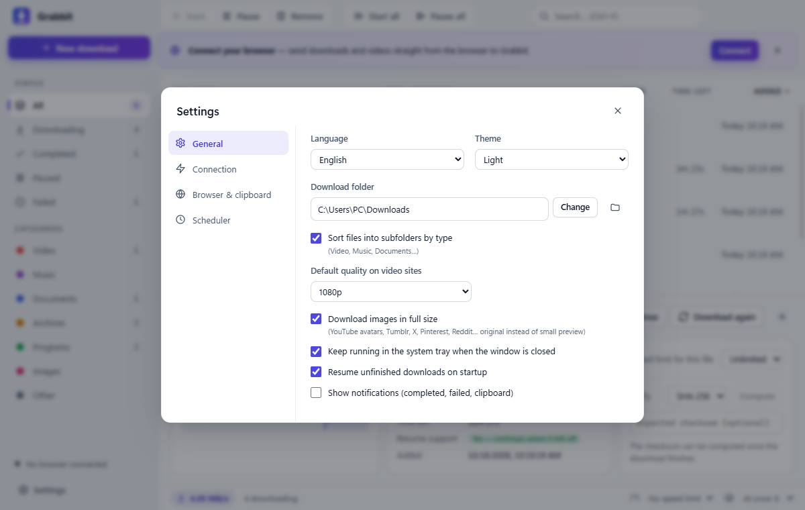

<div align="center">


# Grabbit

**A fast, free, open-source download manager for Windows — an IDM alternative with YouTube & social media support.**

Multi-connection downloads · Resume anything · Browser integration · Videos, MP3 and full-size images · 6 languages

[**⬇ Download for Windows**](https://github.com/emrebayrakk/grabbit/releases/latest) · [🇹🇷 Türkçe](README.tr.md)


</div>

> The name comes from **grab** + **rabbit**: a rabbit that grabs your files fast.

## Why Grabbit?

- **Fast:** each file is split across up to 32 parallel connections. When a connection finishes early, it takes over half of the biggest remaining part (IDM-style dynamic splitting), so the download never ends waiting on one slow connection.
- **Never lose progress:** pause, lose your connection, close the app or even restart the PC — downloads pick up where they left off.
- **Works with your browser:** Chrome, Edge, Brave, Opera and Vivaldi. Browser downloads are captured automatically, and a **“Download this video”** button appears on videos.
- **Videos from 1000+ sites:** YouTube (incl. Shorts), Instagram, TikTok, X/Twitter, Facebook, Twitch, Vimeo, Reddit and more, in any quality from 4K down to 360p, or **audio only as MP3**.
- **Full-size images:** small previews (`=s64`, `s64x64`, `name=small`…) are swapped for the original image.
- **Private by design:** everything runs locally. Cookies are passed only to the site they belong to and temporary cookie files are deleted right away.

## Screenshots

| Video sites: pick a quality or MP3 | Captured from the browser |
| :---: | :---: |
|  |  |
| **Progress window with connection map** | **Add downloads** |
|  |  |

<details>
<summary><b>Dark theme and settings</b></summary>




</details>

## Install

1. Download **`Grabbit-Setup-x.y.z.exe`** from the [latest release](https://github.com/emrebayrakk/grabbit/releases/latest) and run it. Windows 10/11, 64-bit.
2. *(Optional)* Connect your browser: open **Settings → Browser & clipboard** and click **Install extension** next to your browser. The extensions page opens and the extension folder path is copied to your clipboard. Turn on **Developer mode**, click **Load unpacked**, press `Ctrl+V` in the folder dialog and choose **Select folder**. The browser then shows as **“Connected ✓”**.
3. *(Optional)* For video sites, Grabbit asks once to install its video engine — [yt-dlp](https://github.com/yt-dlp/yt-dlp) and [FFmpeg](https://github.com/yt-dlp/FFmpeg-Builds), downloaded from their official GitHub releases and verified with SHA-256. yt-dlp is kept up to date automatically.

> Chrome doesn’t let apps install extensions silently, so step 2 needs one manual click. Once the extension is published in the stores, this becomes one-click.

## Features

### Speed and reliability
- Up to **32 connections per file** with IDM-style dynamic splitting.
- **Resume** after pausing, network drops, closing the app or a reboot.
- **Smart retries** with back-off; a connection that stalls for 30 seconds is renewed, and the connection count drops automatically if the server refuses too many.
- **Expired links:** “Update address” lets you paste a fresh link and continue without starting over.
- **Speed limits:** a global limit plus an optional per-file limit.
- **Starts fast:** file info is fetched while the window opens, videos are pre-resolved when you hover the download button, and resolved video info is reused when the download starts (on YouTube the first bytes arrive in well under a second after you click).

### IDM-style windows
- **File info:** name, size, type, resume support and video quality before the download starts — with *Start download*, *Download later* and *Cancel*.
- **Progress:** status, speed, time left, a live connection map and a per-file speed limit.
- **Completed:** *Open*, *Open folder* or *Close*; *Retry* on errors.

### Video sites (YouTube, Instagram, TikTok, X…)
- Pick **2160p (4K) to 360p** or **audio only (MP3)**; set a default in Settings.
- Video and audio are downloaded separately and merged into one MP4. Video downloads can be paused and resumed too.
- From the browser: the **“Download this video”** button on the player, the right-click menu (**“Download audio as MP3”** also works on YouTube links) or the toolbar icon. In feeds (X, Instagram, TikTok) the post under the cursor is used.
- Videos that need a login use your browser session.
- **Not supported:** DRM-protected content (Netflix, Spotify…), private/members-only videos you don’t have access to, and live streams while they are live. Please respect copyright and each site’s terms of use.

### Streams and video files
- Direct video files (MP4, WebM, MKV…) and **HLS streams (m3u8)**: segments download in parallel and are joined into one file, AES-128 encrypted streams are decrypted, and you can choose the quality.
- Players that keep **audio in a separate stream** (common on movie sites) are handled: video and audio are downloaded and merged into one MP4.
- Players embedded from another domain (iframes) work: Grabbit sends the same Referer/Origin as the player.

### Full-size images
Right-click an image → **“Download image with Grabbit”**. Grabbit picks the largest version the page offers (`srcset`) and knows the size patterns of popular sites:

| Site | Example |
| --- | --- |
| YouTube / Google avatars | `=s64-c-k…` → `=s0` |
| YouTube thumbnails | `hqdefault` → `maxresdefault` |
| Tumblr | `_500` → `_1280`, `.pnj` saved as `.jpg`/`.png` |
| X | `name=small` → `name=orig`, `_normal` → original |
| Pinterest | `236x` → `originals` |
| Reddit, Imgur, Wikipedia, Gravatar, Discord, WordPress | preview → original |

The bigger version is checked with the server first; if it doesn’t exist, the original link is downloaded. You can turn this off in **Settings → General**.

### Browser integration
- Captures link clicks and downloads started by the browser; if Grabbit is closed, the browser downloads as usual. Small files can be left to the browser.
- Toolbar icon with a badge showing how many videos were found on the page.
- Right-click: download a link, video, image, audio or selected links; send all file links or all images on the page.

### Organizing
- Queue with a configurable number of simultaneous downloads.
- Automatic category folders: Video, Music, Documents, Archives, Programs, Images.
- **Scheduler:** start and stop at set times (great for night-time data plans).
- Search, sort, multi-select (`Ctrl`/`Shift`), context menu, drag & drop and `Ctrl+V` to paste links.
- Clipboard watching, checksum verification (SHA-256, SHA-1, MD5, SHA-512), tray icon, Windows notifications and taskbar progress.
- Light and dark themes (follows the system), Windows 11 Mica.

### Languages
**English, Türkçe, Deutsch, Español, Français, Русский.** The system language is used by default and can be changed in **Settings → General**. The browser extension follows the app’s language.

## Keyboard shortcuts

| Shortcut | Action |
| --- | --- |
| `Ctrl+N` | New download |
| `Ctrl+V` | Add links from the clipboard |
| `Ctrl+F` | Search |
| `Space` | Start / pause selected |
| `Enter` / double-click | Open a finished file |
| `Delete` | Remove |
| `Ctrl+A` | Select all |
| `Ctrl+Enter` | “Download” in the New download dialog |

## Build from source

```bash
npm install
npm start          # run the app
npm test           # engine tests + translation check
npm run dist       # build dist/Grabbit-Setup-<version>.exe
npm run pack-extension   # build dist/grabbit-extension-<version>.zip for the stores
```

If you get “electron.exe not found”, run `node node_modules/electron/install.js` once.

Data lives in `%APPDATA%\Grabbit`. Set the `GRABBIT_DATA` environment variable to use another folder (portable use).

<details>
<summary><b>Project structure</b></summary>

```
src/
  main.js            Electron main process: windows, tray, notifications, IPC, clipboard
  preload.js         Safe API exposed to the UI (contextIsolation + sandbox)
  bridge.js          Local server the extension talks to (127.0.0.1 only)
  browsers.js        Finds installed browsers, opens the extensions page
  engine/
    download.js      Multi-connection download: splitting, resume, retries
    hls.js           HLS streams: quality, AES-128, separate audio, merging
    media.js         Video sites via yt-dlp
    tools.js         Installs and updates yt-dlp / FFmpeg (SHA-256 verified)
    fullsize.js      Full-size image rules
    manager.js       Queue, persistence, settings, scheduler
    http.js          Redirects (cookie-safe) and probing
renderer/            UI (plain HTML/CSS/JS, no build step)
extension/           Chromium extension (Manifest V3)
i18n/                Translations (npm run check-i18n)
test/                Engine tests against a local server (npm test)
```

</details>

<details>
<summary><b>Publishing the extension (one-click install)</b></summary>

1. `npm run pack-extension` creates `dist/grabbit-extension-<version>.zip`.
2. Upload it to the [Chrome Web Store developer console](https://chrome.google.com/webstore/devconsole) and, optionally, the free [Edge Add-ons partner center](https://partner.microsoft.com/dashboard/microsoftedge). The stores ask for a privacy policy because the extension uses cookies and access to all sites.
3. Put the store extension IDs into `src/extension-store.json` and rebuild with `npm run dist`.

The button then becomes **“One-click install”**: Grabbit writes an external-extension entry (HKCU, no admin needed) and opens the store page, so the user only clicks **Add**.

</details>

## License

[MIT](LICENSE)
