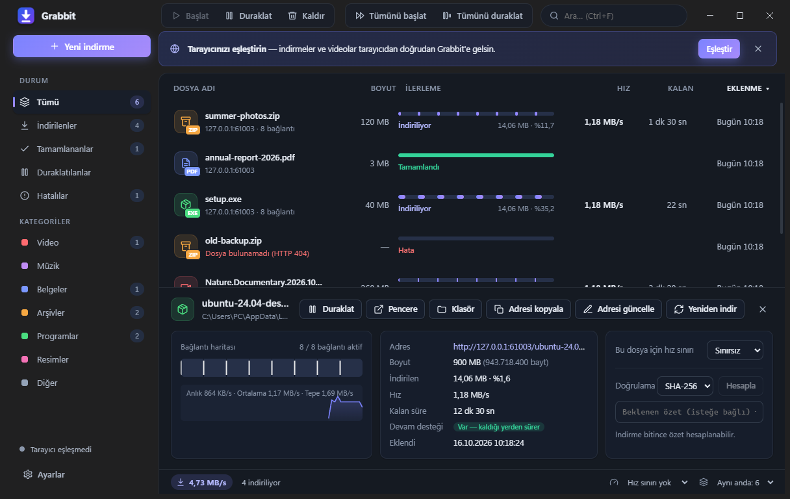
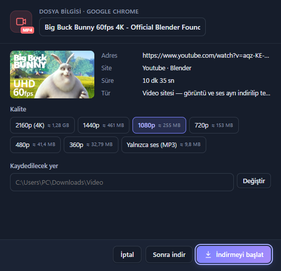
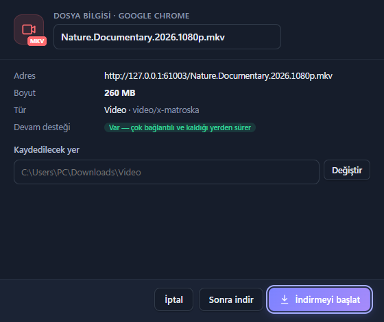
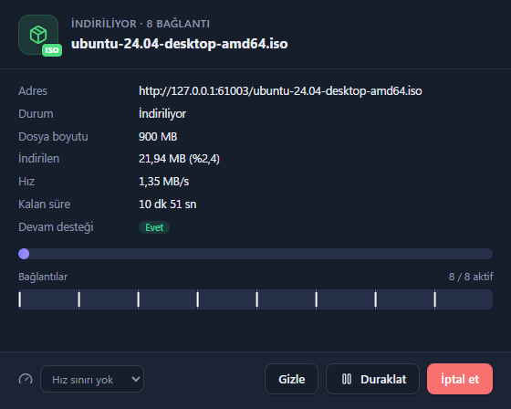
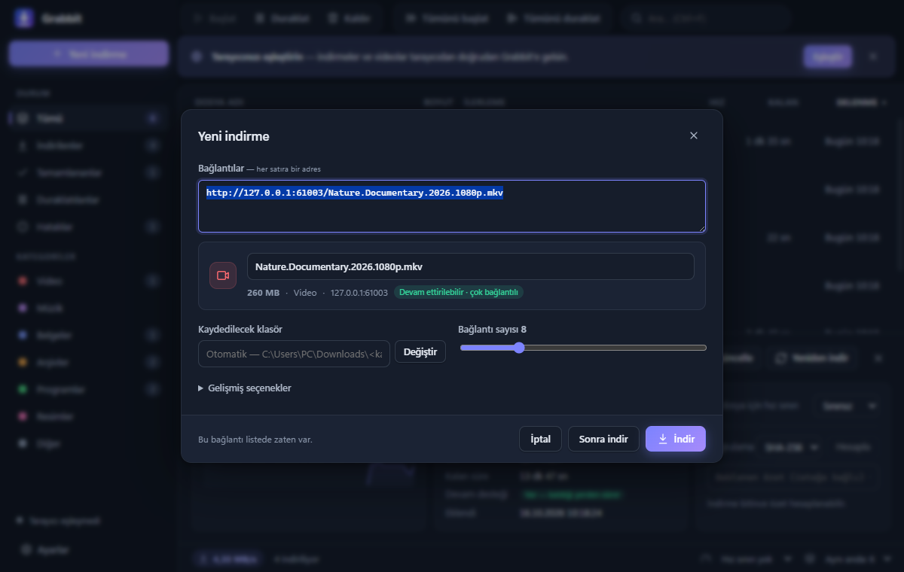
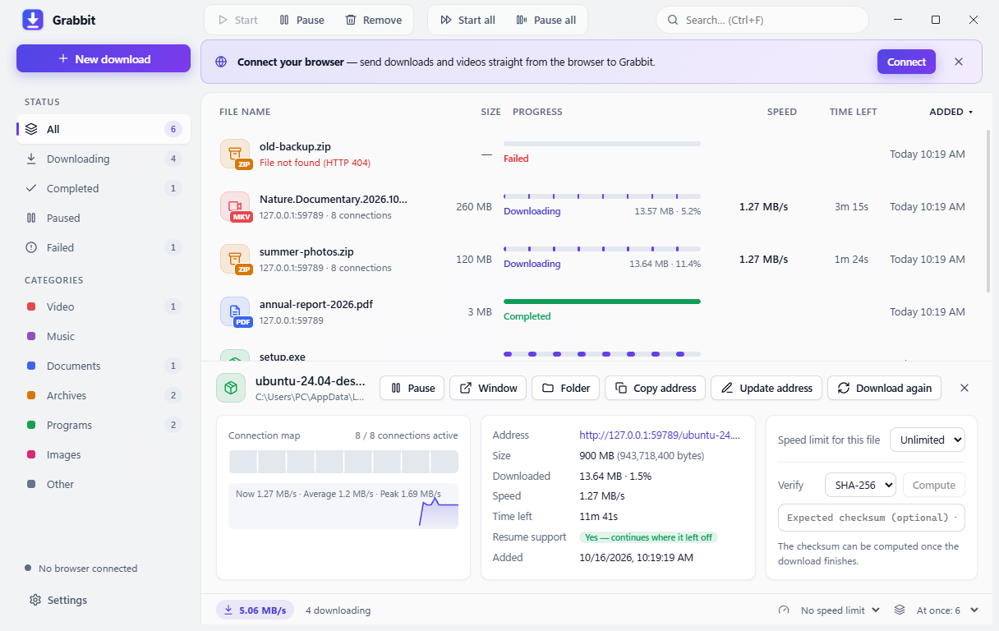
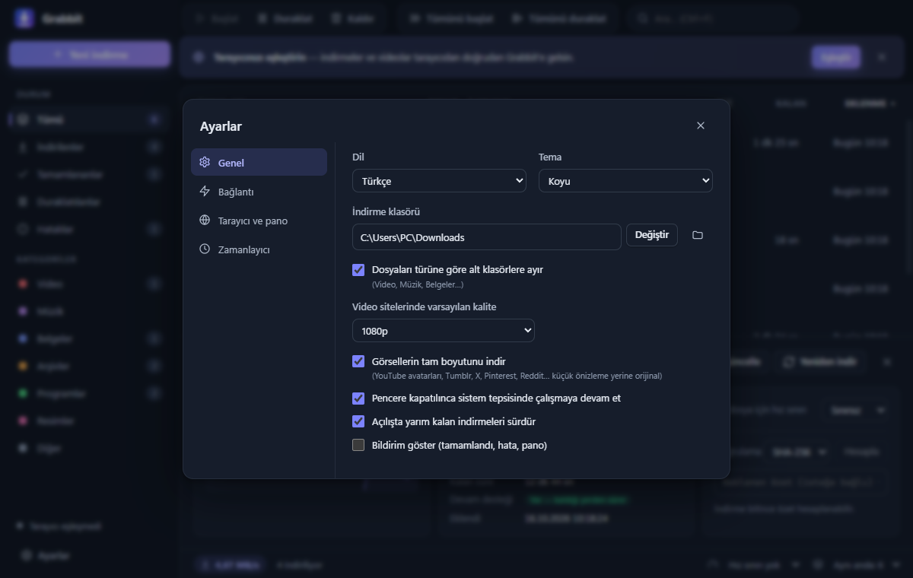

<div align="center">


# Grabbit

**Windows için hızlı, ücretsiz ve açık kaynaklı indirme yöneticisi — YouTube ve sosyal medya destekli bir IDM alternatifi.**

Çok bağlantılı indirme · Kaldığı yerden devam · Tarayıcı entegrasyonu · Video, MP3 ve tam boyut görsel · 6 dil

[**⬇ Windows için indir**](https://github.com/emrebayrakk/grabbit/releases/latest) · [🇬🇧 English](README.md)



</div>

> Adını İngilizce **grab** (kapmak) ve **rabbit** (tavşan) kelimelerinden alır: dosyaları hızla kapan bir tavşan. Uygulamanın eski adı **Turbo İndir**'di; eski sürümden geçenlerin listesi ve ayarları ilk açılışta otomatik taşınır.

## Neden Grabbit?

- **Hızlı:** Her dosya 32'ye kadar paralel bağlantıya bölünür. İşini erken bitiren bağlantı, en çok işi kalan parçanın yarısını devralır (IDM tarzı dinamik bölümleme). Böylece indirmenin sonunda tek bir yavaş bağlantı beklenmez.
- **İlerleme kaybolmaz:** Duraklatma, bağlantı kopması, uygulamayı kapatma, hatta bilgisayarı yeniden başlatma sonrasında indirme kaldığı yerden sürer.
- **Tarayıcınızla çalışır:** Chrome, Edge, Brave, Opera ve Vivaldi. Tarayıcıdaki indirmeler otomatik yakalanır, videoların üzerinde **"Bu videoyu indir"** düğmesi çıkar.
- **1000'den fazla siteden video:** YouTube (Shorts dahil), Instagram, TikTok, X/Twitter, Facebook, Twitch, Vimeo, Reddit ve daha fazlası; 4K'dan 360p'ye istediğiniz kalitede ya da **yalnızca ses (MP3)** olarak.
- **Tam boyut görseller:** Küçük önizlemeler (`=s64`, `s64x64`, `name=small`…) yerine orijinal görsel iner.
- **Gizliliğe saygılı:** Her şey bilgisayarınızda çalışır. Çerezler yalnızca ait oldukları siteye gönderilir, geçici çerez dosyaları hemen silinir.

## Ekran görüntüleri

| Video siteleri: kalite ya da MP3 seçimi | Tarayıcıdan yakalanan dosya |
| :---: | :---: |
|  |  |
| **Bağlantı haritalı ilerleme penceresi** | **Yeni indirme** |
|  |  |

<details>
<summary><b>Açık tema ve ayarlar</b></summary>





</details>

## Kurulum

1. [Son sürümden](https://github.com/emrebayrakk/grabbit/releases/latest) **`Grabbit-Setup-x.y.z.exe`** dosyasını indirip çalıştırın. Windows 10/11, 64 bit.
2. *(İsteğe bağlı)* Tarayıcınızı eşleştirin: **Ayarlar → Tarayıcı ve pano** ekranında tarayıcınızın yanındaki **Eklentiyi kur** düğmesine tıklayın. Eklentiler sayfası açılır ve eklenti klasörünün yolu panoya kopyalanır. **Geliştirici modu**'nu açın, **Paketlenmemiş öğe yükle**'ye tıklayın, açılan pencerede `Ctrl+V` ile yapıştırıp **Klasör seç**'e basın. Tarayıcı listede **"Eşleşti ✓"** olarak görünür.
3. *(İsteğe bağlı)* Video siteleri için Grabbit bir kereliğine video motorunu kurmak için onay ister: [yt-dlp](https://github.com/yt-dlp/yt-dlp) ve [FFmpeg](https://github.com/yt-dlp/FFmpeg-Builds). İkisi de resmi GitHub sürümlerinden indirilir ve SHA-256 ile doğrulanır. yt-dlp kendiliğinden güncel tutulur.

> Chrome, uygulamaların eklentileri sessizce kurmasına izin vermez; bu yüzden 2. adımda bir kez elle tıklamak gerekir. Eklenti mağazalarda yayınlanınca bu adım tek tıka iner.

## Özellikler

### Hız ve dayanıklılık
- Dosya başına **32 bağlantıya kadar**, IDM tarzı dinamik bölümleme.
- Duraklatma, bağlantı kopması, uygulamayı kapatma ya da yeniden başlatma sonrası **kaldığı yerden devam**.
- **Akıllı yeniden deneme:** Artan bekleme süreleriyle tekrar dener. 30 saniye veri gelmeyen bağlantı yenilenir; sunucu fazla bağlantıyı reddederse bağlantı sayısı kendiliğinden düşer.
- **Süresi dolan bağlantılar:** "Adresi güncelle" ile yeni adres yapıştırılır, indirme baştan başlamadan sürer.
- **Hız sınırı:** Tüm indirmeler için genel sınır, istenirse dosya başına ayrıca.
- **Hızlı başlangıç:** Dosya bilgisi pencere açılırken alınır, video düğmesinin üzerine gelince video önceden çözülür ve indirme başlarken bu bilgi yeniden kullanılır. YouTube'da "İndirmeyi başlat"tan sonra ilk bayt bir saniyeden kısa sürede gelir.

### IDM tarzı pencereler
- **Dosya bilgisi:** İndirme başlamadan ad, boyut, tür, devam desteği ve video kalitesi. *İndirmeyi başlat*, *Sonra indir* ve *İptal* seçenekleriyle.
- **İlerleme:** Durum, hız, kalan süre, canlı bağlantı haritası ve dosyaya özel hız sınırı.
- **Tamamlandı:** *Aç*, *Klasörü aç* ya da *Kapat*; hata olursa *Yeniden dene*.

### Video siteleri (YouTube, Instagram, TikTok, X…)
- **2160p (4K)'dan 360p'ye** ya da **yalnızca ses (MP3)**; varsayılan kalite Ayarlar'dan seçilir.
- Görüntü ve ses ayrı indirilip tek bir MP4'te birleştirilir. Video indirmeleri de duraklatılıp sürdürülebilir.
- Tarayıcıdan: oynatıcının üzerindeki **"Bu videoyu indir"** düğmesi, sağ tık menüsü (**"Sesi MP3 olarak indir"** YouTube bağlantılarında da çalışır) ya da araç çubuğu simgesi. Akış sayfalarında (X, Instagram, TikTok) imlecin altındaki gönderi kullanılır.
- Giriş gerektiren videolarda tarayıcıdaki oturumunuz kullanılır.
- **Desteklenmeyenler:** DRM korumalı içerik (Netflix, Spotify…), erişiminiz olmayan gizli/üyelere özel videolar ve sürmekte olan canlı yayınlar. Lütfen telif haklarına ve sitelerin kullanım koşullarına uyun.

### Akışlar ve video dosyaları
- Doğrudan video dosyaları (MP4, WebM, MKV…) ve **HLS akışları (m3u8)**: Parçalar paralel inip tek dosyada birleşir, AES-128 şifreli akışlar çözülür, kalite seçilebilir.
- **Sesi ayrı akışta olan** oynatıcılar (film sitelerinde yaygın) desteklenir: Görüntü ve ses indirilip tek bir MP4'te birleştirilir.
- Başka alan adından gömülü oynatıcılar (iframe) çalışır: Grabbit, oynatıcının gönderdiği Referer/Origin bilgisini aynen gönderir.

### Tam boyut görseller
Görsele sağ tıklayın → **"Görseli Grabbit ile indir"**. Grabbit, sayfanın sunduğu en büyük sürümü (`srcset`) seçer ve popüler sitelerin boyut kalıplarını tanır:

| Site | Örnek |
| --- | --- |
| YouTube / Google avatarları | `=s64-c-k…` → `=s0` |
| YouTube küçük resimleri | `hqdefault` → `maxresdefault` |
| Tumblr | `_500` → `_1280`, `.pnj` → `.jpg`/`.png` olarak kaydedilir |
| X | `name=small` → `name=orig`, `_normal` → orijinal |
| Pinterest | `236x` → `originals` |
| Reddit, Imgur, Wikipedia, Gravatar, Discord, WordPress | önizleme → orijinal |

Büyük sürüm önce sunucuya sorulur; yoksa asıl bağlantı indirilir. **Ayarlar → Genel**'den kapatılabilir.

### Tarayıcı entegrasyonu
- Bağlantı tıklamalarını ve tarayıcının başlattığı indirmeleri yakalar; Grabbit kapalıysa indirmeyi tarayıcı yapar. Küçük dosyalar tarayıcıya bırakılabilir.
- Sayfada bulunan video sayısını rozetle gösteren araç çubuğu simgesi.
- Sağ tık: bağlantı, video, görsel, ses ya da seçili bağlantıları indirme; sayfadaki tüm dosya bağlantılarını veya görselleri gönderme.

### Düzen
- Aynı anda kaç dosya ineceği ayarlanabilen kuyruk.
- Otomatik kategori klasörleri: Video, Müzik, Belgeler, Arşivler, Programlar, Resimler.
- **Zamanlayıcı:** Belirlenen saatte başlat ve durdur (gece tarifesi için ideal).
- Arama, sıralama, çoklu seçim (`Ctrl`/`Shift`), sağ tık menüsü, sürükle-bırak ve `Ctrl+V` ile bağlantı yapıştırma.
- Pano izleme, özet doğrulama (SHA-256, SHA-1, MD5, SHA-512), sistem tepsisi, Windows bildirimleri ve görev çubuğunda ilerleme.
- Açık ve koyu tema (sistemi izler), Windows 11 Mica.

### Diller
**English, Türkçe, Deutsch, Español, Français, Русский.** Varsayılan olarak sistem dili kullanılır; **Ayarlar → Genel**'den değiştirilebilir. Tarayıcı eklentisi uygulamanın dilini izler.

## Klavye kısayolları

| Kısayol | İşlev |
| --- | --- |
| `Ctrl+N` | Yeni indirme |
| `Ctrl+V` | Panodaki bağlantıları ekle |
| `Ctrl+F` | Ara |
| `Boşluk` | Seçilenleri başlat / duraklat |
| `Enter` / çift tık | Tamamlanan dosyayı aç |
| `Delete` | Kaldır |
| `Ctrl+A` | Tümünü seç |
| `Ctrl+Enter` | Yeni indirme penceresinde "İndir" |

## Kaynaktan derleme

```bash
npm install
npm start          # uygulamayı çalıştır
npm test           # motor testleri + çeviri denetimi
npm run dist       # dist/Grabbit-Setup-<sürüm>.exe üret
npm run pack-extension   # mağazalar için dist/grabbit-extension-<sürüm>.zip üret
```

"electron.exe bulunamadı" hatası alırsanız bir kez `node node_modules/electron/install.js` çalıştırın.

Veriler `%APPDATA%\Grabbit` klasöründe tutulur. Taşınabilir kullanım için `GRABBIT_DATA` ortam değişkeniyle başka bir klasör gösterilebilir.

<details>
<summary><b>Proje yapısı</b></summary>

```
src/
  main.js            Electron ana süreç: pencereler, tepsi, bildirimler, IPC, pano
  preload.js         Arayüze açılan güvenli API (contextIsolation + sandbox)
  bridge.js          Eklentinin bağlandığı yerel sunucu (yalnızca 127.0.0.1)
  browsers.js        Kurulu tarayıcıları bulma, eklentiler sayfasını açma
  engine/
    download.js      Çok bağlantılı indirme: bölme, devam, yeniden deneme
    hls.js           HLS akışları: kalite, AES-128, ayrı ses, birleştirme
    media.js         Video siteleri (yt-dlp)
    tools.js         yt-dlp / FFmpeg kurulumu ve güncellemesi (SHA-256 doğrulamalı)
    fullsize.js      Tam boyut görsel kuralları
    manager.js       Kuyruk, kalıcılık, ayarlar, zamanlayıcı
    http.js          Yönlendirme (çerez korumalı) ve yoklama
renderer/            Arayüz (düz HTML/CSS/JS, derleme adımı yok)
extension/           Chromium eklentisi (Manifest V3)
i18n/                Çeviriler (npm run check-i18n)
test/                Yerel sunucuya karşı motor testleri (npm test)
```

</details>

<details>
<summary><b>Eklentiyi mağazada yayınlama (tek tıkla kurulum)</b></summary>

1. `npm run pack-extension` komutu `dist/grabbit-extension-<sürüm>.zip` dosyasını üretir.
2. Bu dosyayı [Chrome Web Mağazası geliştirici panosuna](https://chrome.google.com/webstore/devconsole) ve isterseniz ücretsiz [Edge Eklentileri iş ortağı merkezine](https://partner.microsoft.com/dashboard/microsoftedge) yükleyin. Eklenti çerez ve tüm sitelere erişim izni kullandığı için mağazalar bir gizlilik politikası ister.
3. Mağazanın verdiği eklenti kimliklerini `src/extension-store.json` dosyasına yazın ve `npm run dist` ile yeniden derleyin.

Bundan sonra düğme **"Tek tıkla kur"** olur: Grabbit kayıt defterine (HKCU, yönetici izni gerekmez) harici eklenti girdisi yazar ve mağaza sayfasını açar; kullanıcı yalnızca **Ekle**'ye basar.

</details>

## Lisans

[MIT](LICENSE)
