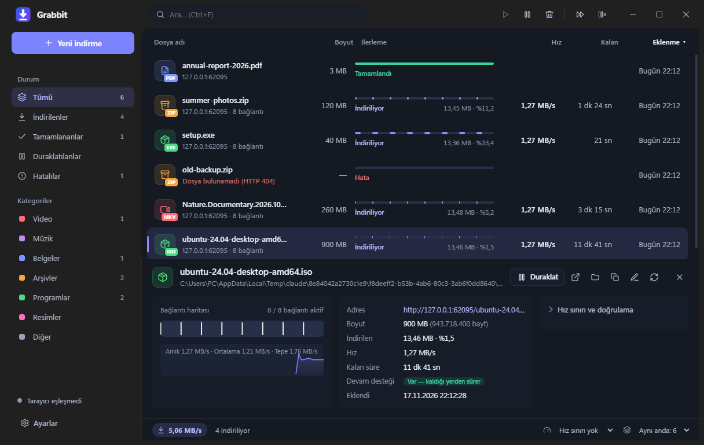
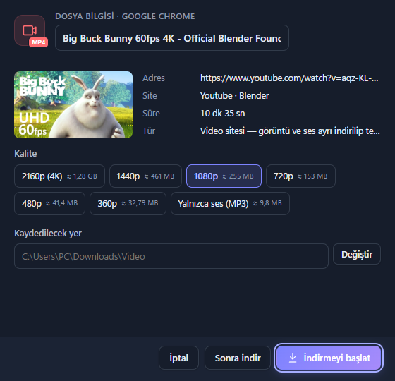
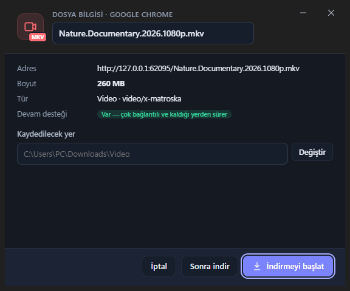
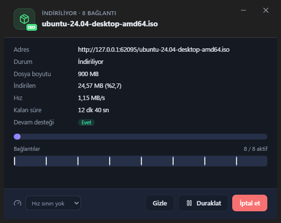
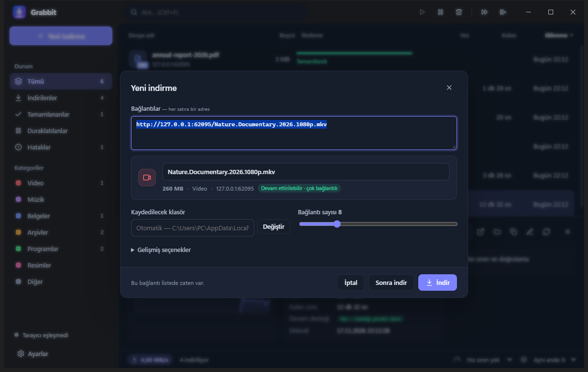
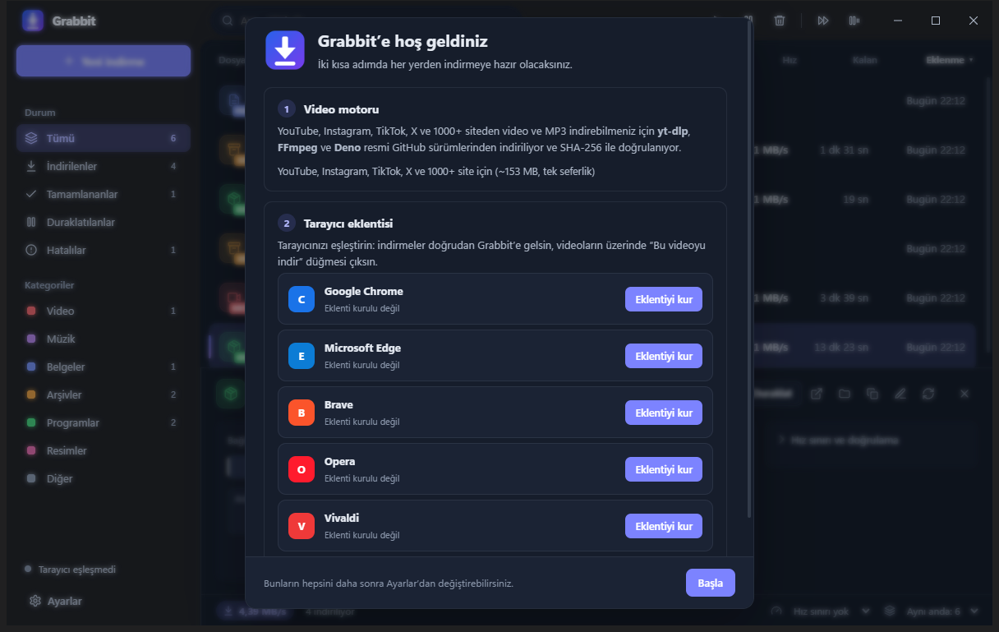
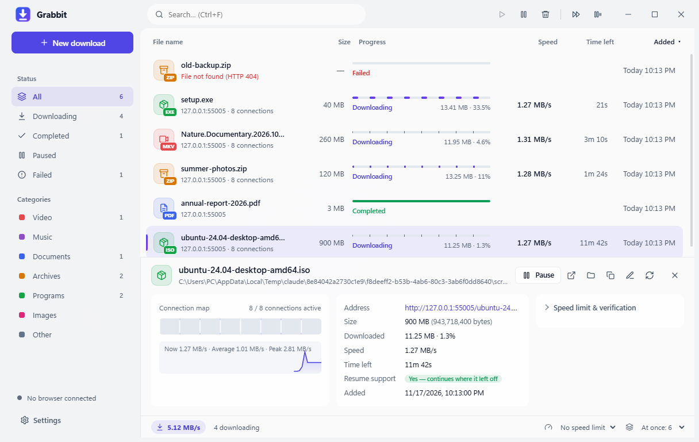
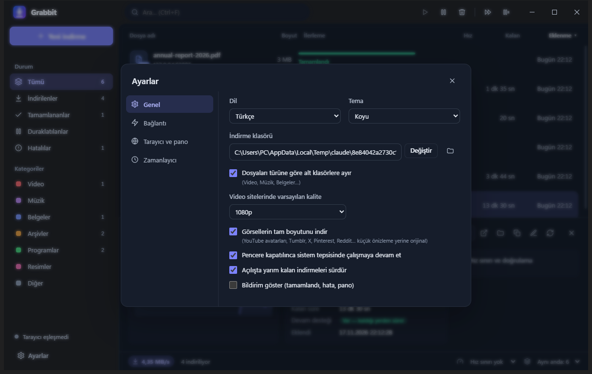

<div align="center">


# Grabbit

**Windows için hızlı, ücretsiz ve açık kaynaklı indirme yöneticisi — YouTube ve sosyal medya destekli bir IDM alternatifi.**

Çok bağlantılı indirme · Kaldığı yerden devam · Tarayıcı entegrasyonu · Video, MP3 ve tam boyut görsel · 6 dil

[**⬇ Windows için indir**](https://github.com/emrebayrakk/grabbit/releases/latest) · [🇬🇧 English](README.md)



</div>

> Adını İngilizce **grab** (kapmak) ve **rabbit** (tavşan) kelimelerinden alır: dosyaları hızla kapan bir tavşan. Uygulamanın eski adı **Turbo İndir**'di; eski sürümden geçenlerin listesi ve ayarları ilk açılışta otomatik taşınır.

## Neden Grabbit?

- **Hızlı:** Her dosya 32'ye kadar paralel bağlantıya bölünür. İşini erken bitiren bağlantı, en çok işi kalan parçanın yarısını devralır (IDM tarzı dinamik bölümleme). Böylece indirmenin sonunda tek bir yavaş bağlantı beklenmez.
- **İlerleme kaybolmaz:** Duraklatma, bağlantı kopması, uygulamayı kapatma, hatta bilgisayarı yeniden başlatma sonrasında indirme kaldığı yerden sürer.
- **Tarayıcınızla çalışır:** Chrome, Edge, Brave, Opera ve Vivaldi. Tarayıcıdaki indirmeler otomatik yakalanır, videoların üzerinde **"Bu videoyu indir"** düğmesi çıkar.
- **1000'den fazla siteden video:** YouTube (Shorts dahil), Instagram, TikTok, X/Twitter, Facebook, Twitch, Vimeo, Reddit ve daha fazlası; 4K'dan 360p'ye istediğiniz kalitede ya da **yalnızca ses (MP3)** olarak.
- **Tam boyut görseller:** Küçük önizlemeler (`=s64`, `s64x64`, `name=small`…) yerine orijinal görsel iner.
- **Hafif:** Rust ve [Tauri](https://tauri.app) ile yazıldı. Kurulum yaklaşık 4 MB; Grabbit tepsideyken yalnızca Rust motoru çalışır (yaklaşık 35 MB bellek), pencere yeniden açılana kadar bellekten tamamen çıkar.
- **Gizliliğe saygılı:** Her şey bilgisayarınızda çalışır. Çerezler yalnızca ait oldukları siteye gönderilir, geçici çerez dosyaları hemen silinir.

## Ekran görüntüleri

| Video siteleri: kalite ya da MP3 seçimi | Tarayıcıdan yakalanan dosya |
| :---: | :---: |
|  |  |
| **Bağlantı haritalı ilerleme penceresi** | **Yeni indirme** |
|  |  |

<details>
<summary><b>Karşılama penceresi, açık tema ve ayarlar</b></summary>







</details>

## Kurulum

1. [Son sürümden](https://github.com/emrebayrakk/grabbit/releases/latest) **`Grabbit_x.y.z_x64-setup.exe`** dosyasını indirip çalıştırın. Windows 10/11, 64 bit. Grabbit 2.x'ten geçiyorsanız eski sürüm kendiliğinden kaldırılır; indirme listeniz ve ayarlarınız korunur.
2. İlk açılışta bir **karşılama penceresi** her şeyi hazırlar:
   - **Video motoru:** [yt-dlp](https://github.com/yt-dlp/yt-dlp), [FFmpeg](https://github.com/yt-dlp/FFmpeg-Builds) ve [Deno](https://github.com/denoland/deno) (YouTube'un istediği JavaScript ortamı) resmi GitHub sürümlerinden hemen inmeye başlar ve SHA-256 ile doğrulanır. yt-dlp kendiliğinden güncel tutulur.
   - **Tarayıcı eklentisi:** Tarayıcınızın yanındaki **Eklentiyi kur** düğmesine tıklayın. Eklentiler sayfası açılır ve eklenti klasörünün yolu panoya kopyalanır: **Geliştirici modu**'nu açın, **Paketlenmemiş öğe yükle**'ye tıklayın, açılan pencerede `Ctrl+V` ile yapıştırıp **Klasör seç**'e basın. Tarayıcı listede **"Eşleşti ✓"** olarak görünür.

> Chrome, uygulamaların eklentileri sessizce kurmasına izin vermez; bu yüzden eklenti için bir kez elle tıklamak gerekir. Eklenti mağazalarda yayınlanınca bu adım tek tıka iner. İki adım da daha sonra **Ayarlar → Tarayıcı ve pano**'da bulunur.

## Özellikler

### Hız ve dayanıklılık
- Dosya başına **32 bağlantıya kadar**, IDM tarzı dinamik bölümleme.
- Duraklatma, bağlantı kopması, uygulamayı kapatma ya da yeniden başlatma sonrası **kaldığı yerden devam**.
- **Akıllı yeniden deneme:** Artan bekleme süreleriyle tekrar dener. 30 saniye veri gelmeyen bağlantı yenilenir; sunucu fazla bağlantıyı reddederse bağlantı sayısı kendiliğinden düşer.
- **Süresi dolan bağlantılar:** "Adresi güncelle" ile yeni adres yapıştırılır, indirme baştan başlamadan sürer.
- **Hız sınırı:** Tüm indirmeler için genel sınır, istenirse dosya başına ayrıca.
- **Hızlı başlangıç:** Dosya bilgisi pencere açılırken alınır, video düğmesinin üzerine gelince video önceden çözülür ve indirme başlarken bu bilgi yeniden kullanılır. YouTube'da "İndirmeyi başlat"tan sonra ilk bayt bir saniyeden kısa sürede gelir.

### IDM tarzı pencereler
- **Dosya bilgisi:** İndirme başlamadan ad, boyut, tür, devam desteği ve video kalitesi. *İndirmeyi başlat*, *Sonra indir* ve *İptal* seçenekleriyle.
- **İlerleme:** Durum, hız, kalan süre, canlı bağlantı haritası ve dosyaya özel hız sınırı.
- **Tamamlandı:** *Aç*, *Klasörü aç* ya da *Kapat*; hata olursa *Yeniden dene*.

### Video siteleri (YouTube, Instagram, TikTok, X…)
- **2160p (4K)'dan 360p'ye** ya da **yalnızca ses (MP3)**; varsayılan kalite Ayarlar'dan seçilir.
- Görüntü ve ses ayrı indirilip tek bir MP4'te birleştirilir. Video indirmeleri de duraklatılıp sürdürülebilir.
- Tarayıcıdan: oynatıcının üzerindeki **"Bu videoyu indir"** düğmesi, sağ tık menüsü (**"Sesi MP3 olarak indir"** YouTube bağlantılarında da çalışır) ya da araç çubuğu simgesi. Akış sayfalarında (X, Instagram, TikTok) imlecin altındaki gönderi kullanılır.
- Giriş gerektiren videolarda tarayıcıdaki oturumunuz kullanılır.
- **Desteklenmeyenler:** DRM korumalı içerik (Netflix, Spotify…), erişiminiz olmayan gizli/üyelere özel videolar ve sürmekte olan canlı yayınlar. Lütfen telif haklarına ve sitelerin kullanım koşullarına uyun.

### Akışlar ve video dosyaları
- Doğrudan video dosyaları (MP4, WebM, MKV…) ve **HLS akışları (m3u8)**: Parçalar paralel inip tek dosyada birleşir, AES-128 şifreli akışlar çözülür, kalite seçilebilir.
- **Sesi ayrı akışta olan** oynatıcılar (film sitelerinde yaygın) desteklenir: Görüntü ve ses indirilip tek bir MP4'te birleştirilir.
- Başka alan adından gömülü oynatıcılar (iframe) çalışır: Grabbit, oynatıcının gönderdiği Referer/Origin bilgisini aynen gönderir.

### Tam boyut görseller
Görsele sağ tıklayın → **"Görseli Grabbit ile indir"**. Grabbit, sayfanın sunduğu en büyük sürümü (`srcset`) seçer ve popüler sitelerin boyut kalıplarını tanır:

| Site | Örnek |
| --- | --- |
| YouTube / Google avatarları | `=s64-c-k…` → `=s0` |
| YouTube küçük resimleri | `hqdefault` → `maxresdefault` |
| Tumblr | `_500` → `_1280`, `.pnj` → `.jpg`/`.png` olarak kaydedilir |
| X | `name=small` → `name=orig`, `_normal` → orijinal |
| Pinterest | `236x` → `originals` |
| Reddit, Imgur, Wikipedia, Gravatar, Discord, WordPress | önizleme → orijinal |

Büyük sürüm önce sunucuya sorulur; yoksa asıl bağlantı indirilir. **Ayarlar → Genel**'den kapatılabilir.

### Tarayıcı entegrasyonu
- **Akıllı "Bu videoyu indir" düğmesi:** Yalnızca imlecin altındaki videoya ait olanı sunar: videonun kendi dosyası ya da süresi ona uyan akış. Reklam ve önizleme klipleri, tekrarlanan listeler ve ayrı ses izleri elenir. Seçenekler rastgele dosya adlarıyla değil, sayfa başlığı, kalite ve süreyle adlandırılır (ör. *"Uzay Belgeseli · 1080p · 1:39:22"*). Tek anlamlı seçenek varsa menü açılmadan doğrudan iner.
- Bağlantı tıklamalarını ve tarayıcının başlattığı indirmeleri yakalar; Grabbit kapalıysa indirmeyi tarayıcı yapar. Küçük dosyalar tarayıcıya bırakılabilir.
- Sayfada bulunan video sayısını rozetle gösteren araç çubuğu simgesi.
- Sağ tık: bağlantı, video, görsel, ses ya da seçili bağlantıları indirme; sayfadaki tüm dosya bağlantılarını veya görselleri gönderme.

### Düzen
- Aynı anda kaç dosya ineceği ayarlanabilen kuyruk.
- Otomatik kategori klasörleri: Video, Müzik, Belgeler, Arşivler, Programlar, Resimler.
- **Zamanlayıcı:** Belirlenen saatte başlat ve durdur (gece tarifesi için ideal).
- Arama, sıralama, çoklu seçim (`Ctrl`/`Shift`), sağ tık menüsü, sürükle-bırak ve `Ctrl+V` ile bağlantı yapıştırma.
- Pano izleme, özet doğrulama (SHA-256, SHA-1, MD5, SHA-512), sistem tepsisi, Windows bildirimleri ve görev çubuğunda ilerleme.
- Açık ve koyu tema (sistemi izler), Windows 11 Mica.

### Diller
**English, Türkçe, Deutsch, Español, Français, Русский.** Varsayılan olarak sistem dili kullanılır; **Ayarlar → Genel**'den değiştirilebilir. Tarayıcı eklentisi uygulamanın dilini izler.

## Klavye kısayolları

| Kısayol | İşlev |
| --- | --- |
| `Ctrl+N` | Yeni indirme |
| `Ctrl+V` | Panodaki bağlantıları ekle |
| `Ctrl+F` | Ara |
| `Boşluk` | Seçilenleri başlat / duraklat |
| `Enter` / çift tık | Tamamlanan dosyayı aç |
| `Delete` | Kaldır |
| `Ctrl+A` | Tümünü seç |
| `Ctrl+Enter` | Yeni indirme penceresinde "İndir" |

## Kaynaktan derleme

Gerekenler: [Rust](https://rustup.rs) (stable, MSVC) ve Tauri CLI (`cargo install tauri-cli --version "^2"`). Windows 10/11'de WebView2 zaten kuruludur.

```bash
cargo run -p grabbit                    # uygulamayı çalıştır
cargo test                              # motor, köprü, çeviri ve video sitesi testleri
cd src-tauri && cargo tauri build       # kurulum: target/release/bundle/nsis/Grabbit_<sürüm>_x64-setup.exe
pwsh scripts/pack-extension.ps1         # mağazalar için dist/grabbit-extension-<sürüm>.zip
```

Veriler `%APPDATA%\Grabbit` klasöründe tutulur. Taşınabilir kullanım için `GRABBIT_DATA` ortam değişkeniyle başka bir klasör gösterilebilir.

<details>
<summary><b>Proje yapısı</b></summary>

```
core/                Rust kütüphanesi (arayüzden bağımsız, testli)
  src/download.rs    Çok bağlantılı indirme: bölme, devam, yeniden deneme, takılma denetimi
  src/hls.rs         HLS akışları: kalite, AES-128, ayrı ses, birleştirme
  src/media.rs       Video siteleri (yt-dlp; YouTube için Deno)
  src/tools.rs       yt-dlp / FFmpeg / Deno kurulumu ve güncellemesi (SHA-256 doğrulamalı)
  src/manager.rs     Kuyruk, kalıcılık, ayarlar, zamanlayıcı, yoklama önbelleği
  src/bridge.rs      Eklentinin bağlandığı yerel sunucu (yalnızca 127.0.0.1)
  src/client.rs      Tarayıcıyı Windows TCP tablosundan tanıma
  src/http.rs        Yönlendirme (çerez korumalı) ve yoklama
  src/fullsize.rs    Tam boyut görsel kuralları
  src/i18n.rs        Arayüzle aynı çeviri dosyalarını okur
  tests/engine.rs    Yerel sunucuya karşı 41 motor senaryosu
src-tauri/           Masaüstü uygulaması (Tauri 2): pencereler, tepsi, bildirimler, komutlar
ui/                  Arayüz (düz HTML/CSS/JS, derleme adımı yok) + çeviriler (ui/i18n)
extension/           Chromium eklentisi (Manifest V3)
```

</details>

<details>
<summary><b>Eklentiyi mağazada yayınlama (tek tıkla kurulum)</b></summary>

1. `pwsh scripts/pack-extension.ps1` komutu `dist/grabbit-extension-<sürüm>.zip` dosyasını üretir.
2. Bu dosyayı [Chrome Web Mağazası geliştirici panosuna](https://chrome.google.com/webstore/devconsole) ve isterseniz ücretsiz [Edge Eklentileri iş ortağı merkezine](https://partner.microsoft.com/dashboard/microsoftedge) yükleyin. Eklenti çerez ve tüm sitelere erişim izni kullandığı için mağazalar bir gizlilik politikası ister.
3. Mağazanın verdiği eklenti kimliklerini `core/extension-store.json` dosyasına yazın ve kurulumu yeniden derleyin.

Bundan sonra düğme **"Tek tıkla kur"** olur: Grabbit kayıt defterine (HKCU, yönetici izni gerekmez) harici eklenti girdisi yazar ve mağaza sayfasını açar; kullanıcı yalnızca **Ekle**'ye basar.

</details>

## Lisans

[MIT](LICENSE)
